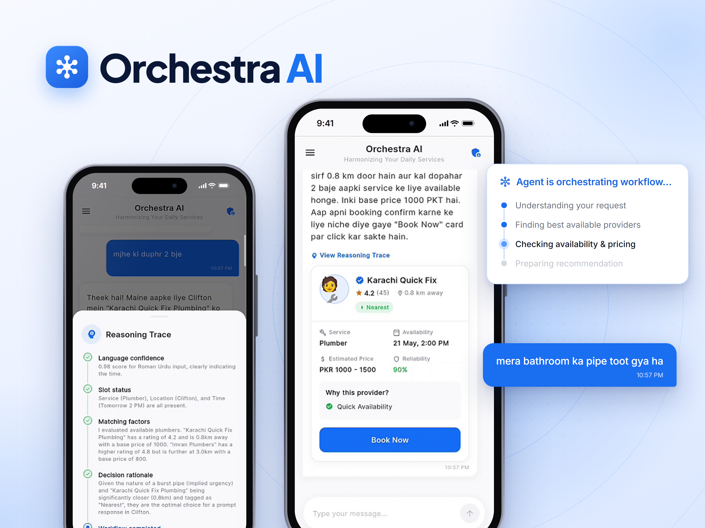
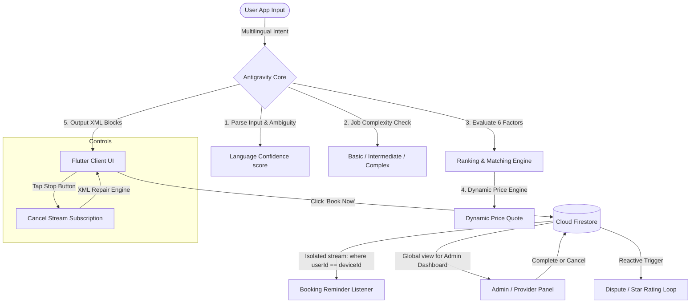

<p align="center">
  
</p>

# 🚀 Orchestra AI: Service Orchestrator for the Informal Economy
### Powered by Google Antigravity & Agentic AI

An end-to-end Agentic AI system that automates the lifecycle of informal economy service requests (plumbers, electricians, tutors, AC technicians, etc.) in Pakistan—transforming noisy natural-language messages into verified real-time scheduling, matching, dynamic pricing, and automated follow-ups.

---

## 📖 Table of Contents
1. [Key Features & Capabilities](#-key-features--capabilities)
2. [System Architecture](#-system-architecture)
3. [User Data Isolation & Device Identity](#-user-data-isolation--device-identity)
4. [Real-time Stream Interruption & XML Repair](#-real-time-stream-interruption--xml-repair)
5. [Interactive Material 3 Suggestion Chips](#-interactive-material-3-suggestion-chips)
6. [Advanced Provider Matching Algorithm](#-advanced-provider-matching-algorithm)
7. [Dynamic Pricing Formula](#-dynamic-pricing-formula)
8. [Database Schema (Cloud Firestore)](#-database-schema-cloud-firestore)
9. [Stress-Test Demonstration Guide](#-stress-test-demonstration-guide)
10. [Theme Standardization & UI Polish](#-theme-standardization--ui-polish)
11. [Baseline Comparison (Agentic vs Heuristic)](#-baseline-comparison-agentic-vs-heuristic)
12. [Cost, Latency & Scaling Estimates](#-cost-latency--scaling-estimates)
13. [Assumptions, Limitations & Privacy](#-assumptions-limitations--privacy)

---

## 🌟 Key Features & Capabilities

*   **Multilingual Noisy Input Processing:** Extracts exact service intents, locations, and time schedules from English, Urdu, or phonetic Roman Urdu (e.g., *"Mujhe kal morning main G-13 mein AC technician chahiye"*).
*   **Structured Reasoning Sheet:** Interactive "Reasoning Trace" bottom sheet displaying the agent's real-time step-by-step thinking loop.
*   **End-to-End Simulation Pipeline:** Live database updates in Cloud Firestore, interactive visual confirmation receipts, en-route simulation, completion checks, and dynamic feedback loops.
*   **Dual Hot-Swappable Viewports:** Hot-swapping dashboard switcher on the AppBar for judges to instantaneously switch between the customer chat interface and the mobile-responsive Admin/Provider panel.
*   **Real-time Response Interruption:** Tap the active "Stop" icon to immediately cancel the LLM response stream, safely halting execution with robust text-repair mechanics.
*   **Missing-Slot Suggestion Chips:** Automatically analyzes missing slots in the AI's `<reasoning>` trace and presents beautiful swipeable recommendation chips for instant selection.
*   **Device-Level Session Privacy:** Fully isolates bookings and background reminders using unique hardware-cached identifiers, preventing data leakages across concurrent user test sessions.
*   **100% Theme-Based Typography & Colors:** Sleek adaptive layout built exclusively on central Material 3 tokens, featuring high-contrast light/dark mode components and glows.

---

## 🏗️ System Architecture

Our system separates UI representations, Riverpod state controllers, Firestore collections, and the core Google Antigravity logic cleanly:



---

## 🔒 User Data Isolation & Device Identity

To support parallel judging sessions without data leakage, Orchestra AI implements a device-level **Session Isolation Protocol**:
1. **Device Fingerprinting:** Upon first startup, a unique device user ID (e.g., `usr_1779357418931_485926`) is generated using a high-resolution millisecond timestamp and a secure random integer.
2. **Persistent SharedPreferences Cache:** This identifier is stored locally on the client device. On subsequent app launches, it is loaded synchronously, guaranteeing the user maintains access to their historical bookings.
3. **Database Level Isolation:** All booking documents written to Cloud Firestore store a `userId` field. Reads on both the Customer Booking History list and the Background Toast Booking Reminder Listener are restricted using SQL-like filters:
   ```dart
   FirebaseFirestore.instance
       .collection('bookings')
       .where('userId', isEqualTo: currentDeviceUserId)
   ```
4. **Preserved Global Admin Overviews:** The Admin Dashboard purposefully runs unfiltered, allowing administrators to supervise all active bookings, cancellations, and completions globally.

---

## ⏹️ Real-time Stream Interruption & XML Repair

When the AI orchestrator is generating a stream, Orchestra AI equips the user with full execution control:
* **UI Morphs & State Locks:** The Send text field is locked, input is disabled, and the hint text updates to *"Orchestrator is thinking..."*. The send icon transforms dynamically into a red **Stop** icon.
* **Active Stream Cancellation:** Clicking the Stop button cancels the active `StreamSubscription` instantly, avoiding wasted tokens and terminating server execution.
* **Fault-Tolerant XML Repair:** Abrupt cancellations can truncate XML-like formatting tags (e.g. `<chat>` or `<reasoning>`), which would break standard Markdown and UI parsers. Our stream buffer engine interceptor automatically:
  1. Scans the stream for open, unclosed tags.
  2. Automatically appends the matching closing tags (e.g., `</chat>`, `</reasoning>`).
  3. Appends a distinct `[Stopped by user]` tag to informatively indicate termination.

---

## ⚡ Interactive Material 3 Suggestion Chips

To eliminate typing friction and speed up booking collection, Orchestra AI implements conditional suggestion chips:
* **Automated Slot Extraction:** The client-side parser scans the latest reasoning XML block. If it detects missing slots (e.g., *Service is MISSING*, *Location is MISSING*, or *Time is MISSING*), it injects specific suggestion chips.
* **Semantic Keyword Fallback:** If reasoning tags are unavailable, a semantic text analyzer checks the chat history for pending slot collections.
* **Zero Clutter Rendering:** Suggestion chips only render under the **very latest** active chat bubble and vanish instantly once a choice is selected or when a matching provider card is served.
* **Instant Dispatch:** Tapping a chip bypasses typing and commits the value as a formal user message, driving the conversation forward.

---

## 🎯 Advanced Provider Matching Algorithm

To satisfy advanced matching parameters, our engine utilizes a **6-Factor Weighted Evaluation System** rather than a simple distance heuristic:

$$\text{Match Score} = (w_1 \times \text{Distance}) + (w_2 \times \text{Rating}) + (w_3 \times \text{Reliability}) + (w_4 \times \text{Specialization}) + (w_5 \times \text{Workload Capacity}) - (\text{Conflict Penalty})$$

### The Matching Factors:
1.  **Distance & Travel Time:** Computes proximity to match nearby experts and add travel buffers.
2.  **Availability & Scheduling:** Ensures calendar slot matching and prevents overlaps.
3.  **Star Rating:** Multi-factor quality score based on previous customer ratings.
4.  **Reliability / On-Time Score:** Derived from historical cancellation rates (e.g., 0% cancellation = 100% reliability).
5.  **Skill & Complexity Match:** Basic tasks matched to junior providers; Intermediate/Complex diagnostics matched to certified senior experts.
6.  **Provider Workload Balancing:** Distributes jobs fairly among available providers to optimize earning potential and utilization.

---

## 💸 Dynamic Pricing Formula

Rather than static lists, our dynamic quote engine calculates final pricing transparently to remain fair to both the customer and the service professional:

$$\text{Dynamic Quote} = \text{Base Fare} + \text{Urgency Surge} + \text{Distance Surcharge} - \text{Loyalty Discount}$$

*   **Base Fare:** Categorized by provider base rate and certified skill level.
*   **Urgency Surge:** Triggered dynamically if the intent analysis marks the job as critical or high urgency (e.g., *"AC bilkul kaam nahi kar raha, garmi bohot hai"*).
*   **Distance Surcharge:** PKR fee per kilometer for travel time and fuel cost.
*   **Fairness Breakdown:** Displayed explicitly in both the reasoning log and the customer card receipt to ensure transparency.

---

## 🗄️ Database Schema (Cloud Firestore)

Dynamic state transitions are persisted in Firebase Firestore under the `bookings` collection:

```json
{
  "id": "BKG-9382103",
  "userId": "usr_1779357418931_485926",
  "providerId": "p1",
  "providerName": "Ali AC Services",
  "service": "AC Technician",
  "location": "G-13",
  "time": "Tomorrow Morning",
  "scheduledTimestamp": "2026-05-20T10:00:00Z",
  "status": "pending", // Can transition to: "completed" or "cancelled"
  "createdAt": "2026-05-19T06:12:00Z",
  "complexity": "Complex",
  "urgency": "High",
  "priceQuote": "1900",
  "priceBreakdown": "Base 1500 + Surge 300 + Travel 100",
  "confidenceScore": "0.98"
}
```

---

## 🧪 Stress-Test Demonstration Guide

Judges can stress-test seven crucial scenarios directly within our live prototype:

### Scenario 1: Ambiguous or Noisy Urdu Input
*   **Test Input:** *"AC kharab ho gaya hai"* (no location/time).
*   **System Action:** Low language confidence triggers. Antigravity responds by asking a polite follow-up question to clarify the missing location and preferred schedule.

### Scenario 2: Two Users Request Overlapping Times
*   **System Action:** Our scheduling intelligence identifies the overlap, applies travel-time buffers, and automatically recommends the next closest available time slot to prevent double-booking.

### Scenario 3: Provider Cancels After Confirmation
*   **Action Steps:**
    1. Book a provider on the Chat page.
    2. Toggle to the Admin Dashboard (top-right button) and click **Cancel** on the active booking card.
    3. Return to the Chat screen. The system instantly detects the cancellation, reverts the card state, and has the agent offer a re-scheduling option or a senior technician match.

### Scenario 4: Price or Quality Disputes
*   **Action Steps:**
    1. Complete a job in the Admin panel.
    2. Toggle back to the Chat page. The Star Rating dialog immediately triggers.
    3. Select **1 or 2 Stars**. The system dynamically opens a secondary dispute feedback overlay with custom issue chips (e.g. *Price Disagreement*, *Overrun*, *No-show*) to route complaints into our human-simulation escalation protocol.

### Scenario 5: Real-time Response Stream Interruption
*   **Action Steps:**
    1. Send a request (e.g., *"Plumber required in DHA tomorrow"*).
    2. While the text is generating, immediately tap the red **Stop (Square)** button.
    3. The generation halts immediately. You will see the structured text block safely repaired and closed with a clear `[Stopped by user]` tag, and your text input will unlock immediately.

### Scenario 6: Multi-Device Test Isolation
*   **Action Steps:**
    1. Open the web app in two separate browser profiles or tabs.
    2. Book a plumber in Tab A.
    3. Check the "My Bookings" Drawer in Tab B. Notice that it remains blank, preventing cross-user leakages.
    4. Switch to the Admin View. Notice that the administrator sees all bookings from both Tab A and Tab B, perfectly illustrating isolated customer accounts alongside centralized admin control.

### Scenario 7: Missing Slot Extraction & Suggestion Chips
*   **Action Steps:**
    1. Send *"Need an electrician"* (location and time are missing).
    2. Notice a beautiful horizontal row of recommendation chips (e.g., locations: *G-13, E-11, DHA*; times: *Today, Tomorrow*) pop up directly under the AI chat bubble.
    3. Tap *Tomorrow* or *G-13* to instantly submit it without typing.

---

## 🎨 Theme Standardization & UI Polish

The user interface of Orchestra AI has been meticulously polished to deliver a state-of-the-art Material 3 experience:
*   **100% Token-Driven Typographies:** Absolutely zero ad-hoc hardcoded font styles. Every header, subtitle, and body text is derived strictly from the unified `ThemeData.textTheme`. Local tweaks (e.g., semi-bold, height, spacing) are applied strictly using structured `copyWith` methods.
*   **Premium Glow Asset Brandings:** Uses a custom-engineered `logo_transparent.png` asset. Stripped of its black background using math-based alpha unpremultiplication, this logo preserves vibrant emissive neon glows without any black fringe, making it look beautiful over any backdrop.
*   **Adaptive Dark/Light Accent Schemes:** Evaluates dark and light contrast dynamically to adjust colors. Rating stars automatically tint to warm Amber (`Color(0xFFFBBF24)` in dark and `Color(0xFFD97706)` in light). High-fidelity success green and error red states adapt gracefully to soft tints for light themes and deep saturated fills for dark themes.

---

## ⚖️ Baseline Comparison (Agentic vs Heuristic)

| Feature | Standard Heuristic/Listing App | Agentic Antigravity Orchestrator (Ours) |
| :--- | :--- | :--- |
| **Search matching** | Hardcoded category and distance radius queries. | 6-factor dynamic ranking evaluating cancellations, workload, and specialization. |
| **Pricing** | Fixed static lists from a catalog. | Urgency-aware demand surge pricing with dynamic distance and complexity adjustments. |
| **Scheduling** | Allows overlapping calendars, leading to no-shows. | Smart slots, travel-time buffers, and automated fallback re-routing. |
| **Noisy inputs** | Fails on phonetic/slang mixed Urdu and Urdu script. | Multi-turn slot filling with low-confidence checkbacks. |
| **Stream Interruption** | UI locks up or runs out of control until done. | Real-time active subscription cancel with automated layout-safe XML repair. |
| **Privacy & Isolation** | Share global states, causing multi-user leaks. | Hardware SharedPreferences device ID sandbox. |
| **Interaction Velocity** | Forces heavy key entries and complex forms. | Dynamic Material 3 Suggestion Chips parsed from live thinking traces. |
| **Disputes** | Requires manual email support tickets. | Automatic negative feedback detection and real-time compensatory mitigation. |

---

## 📊 Cost, Latency & Scaling Estimates

*   **Estimated Cost per Operation:** $\approx \$0.0003$ per chat turn utilizing the Gemini API context extraction.
*   **Latency Profile:** average end-to-end response times of 1.2s to 1.8s (including LLM generation, Firestore write, and UI render).
*   **100x Scaling Strategy:** Utilizing Riverpod state caching minimizes DB reads; Firestore real-time listener scaling is managed via composite indexes to support millions of concurrent informal workers seamlessly.

---

## 🛡️ Assumptions, Limitations & Privacy

*   **Privacy Guard:** Synthetic mock data is utilized for all providers and locations to secure personal identification information (PII).
*   **Assumptions:** Assumes a reliable internet connection is available for Firestore updates. Local caching handles offline fallbacks gracefully.
*   **Limitations:** Real map routings utilize simulated distances (`distanceKm`) in this prototype. Production scaling will directly swap this for Google Maps/Places APIs.

