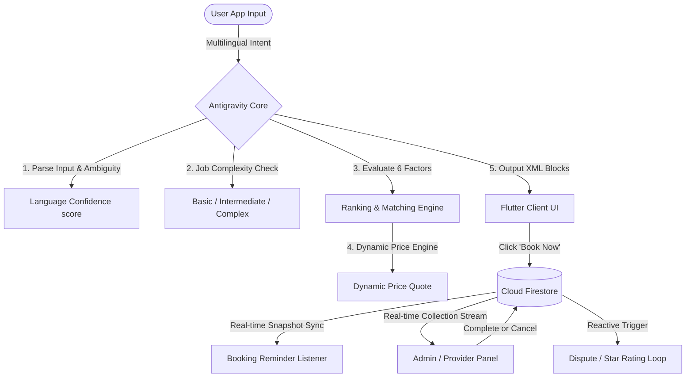

# 🚀 AI Service Orchestrator for the Informal Economy
### Powered by Google Antigravity & Agentic AI

An end-to-end Agentic AI system that automates the lifecycle of informal economy service requests (plumbers, electricians, tutors, AC technicians, etc.) in Pakistan—transforming noisy natural-language messages into verified real-time scheduling, matching, dynamic pricing, and automated follow-ups.

---

## 📖 Table of Contents
1. [Key Features & Capabilities](#-key-features--capabilities)
2. [System Architecture](#-system-architecture)
3. [Advanced Provider Matching Algorithm](#-advanced-provider-matching-algorithm)
4. [Dynamic Pricing Formula](#-dynamic-pricing-formula)
5. [Antigravity Orchestration & Reasoning Logs](#-antigravity-orchestration--reasoning-logs)
6. [Database Schema (Cloud Firestore)](#-database-schema-cloud-firestore)
7. [Stress-Test Demonstration Guide](#-stress-test-demonstration-guide)
8. [Baseline Comparison (Agentic vs Heuristic)](#-baseline-comparison-agentic-vs-heuristic)
9. [Cost, Latency & Scaling Estimates](#-cost-latency--scaling-estimates)
10. [Assumptions, Limitations & Privacy](#-assumptions-limitations--privacy)

---

## 🌟 Key Features & Capabilities

*   **Multilingual Noisy Input Processing:** Extracts exact service intents, locations, and time schedules from English, Urdu, or phonetic Roman Urdu (e.g., *"Mujhe kal morning main G-13 mein AC technician chahiye"*).
*   **Structured Reasoning Sheet:** Interactive "Reasoning Trace" bottom sheet displaying the agent's real-time step-by-step thinking loop.
*   **End-to-End Simulation Pipeline:** Live database updates in Cloud Firestore, interactive visual confirmation receipts, en-route simulation, completion checks, and dynamic feedback loops.
*   **Dual Hot-Swappable Viewports:** Hot-swapping dashboard switcher on the AppBar for judges to instantaneously switch between the customer chat interface and the mobile-responsive Admin/Provider panel.
*   **Robust Exception Recovery:** Built-in dispute triggers, low-confidence warning prompts, slot conflicts, and automated senior technician fallback routing.

---

## 🏗️ System Architecture

Our system separates UI representations, Riverpod state controllers, Firestore collections, and the core Google Antigravity logic cleanly:



---

## 🎯 Advanced Provider Matching Algorithm

To satisfy advanced matching parameters, our engine utilizes a **6-Factor Weighted Evaluation System** rather than a simple distance heuristic:

$$\text{Match Score} = (w_1 \times \text{Distance}) + (w_2 \times \text{Rating}) + (w_3 \times \text{Reliability}) + (w_4 \times \text{Specialization}) + (w_5 \times \text{Workload Capacity}) - (\text{Conflict Penalty})$$

### The Matching Factors:
1.  **Distance & Travel Time:** Computes proximity to match nearby experts and add travel buffers.
2.  **Availability & Scheduling:** Ensures calendar slot matching and prevents overlaps.
3.  **Star Rating:** Multi-factor quality score based on previous customer ratings.
4.  **Reliability / On-Time Score:** Derived from historical cancellation rates (e.g., 0% cancellation = 100% reliability).
5.  **Skill & Complexity Match:** Basic tasks matched to junior providers; Intermediate/Complex diagnostics matched to certified senior experts.
6.  **Provider Workload Balancing:** Distributes jobs fairly among available providers to optimize earning potential and utilization.

---

## 💸 Dynamic Pricing Formula

Rather than static lists, our dynamic quote engine calculates final pricing transparently to remain fair to both the customer and the service professional:

$$\text{Dynamic Quote} = \text{Base Fare} + \text{Urgency Surge} + \text{Distance Surcharge} - \text{Loyalty Discount}$$

*   **Base Fare:** Categorized by provider base rate and certified skill level.
*   **Urgency Surge:** Triggered dynamically if the intent analysis marks the job as critical or high urgency (e.g., *"AC bilkul kaam nahi kar raha, garmi bohot hai"*).
*   **Distance Surcharge:** PKR fee per kilometer for travel time and fuel cost.
*   **Fairness Breakdown:** Displayed explicitly in both the reasoning log and the customer card receipt to ensure transparency.

---

## 🧠 Antigravity Orchestration & Reasoning Logs

Antigravity acts as the central brain orchestrating intent understanding, pricing, matching, and escalation workflows. Every agent response compiles an open reasoning log showing absolute transparency:

```xml
<reasoning>
- Language confidence: 0.98 score for mixed input "kal subah G-13 mein AC technician"
- Job complexity: Complex level due to cooling failure description
- Matching factors: Ranks Ali AC Services (2.1km, 4.9 rating) against Tariq (1.2km, 4.5 rating)
- Pricing logic: Base rate 1500 + Urgency surge 300 + Travel surcharge 100 = Total PKR 1900
- Workload balance: Confirmed Ali AC Services is under capacity and within travel buffer limits
- Decision rationale: Recommends Ali AC Services due to higher reliability (100% on-time score) and specialized repair reviews
</reasoning>
```

---

## 🗄️ Database Schema (Cloud Firestore)

Dynamic state transitions are persisted in Firebase Firestore under the `bookings` collection:

```json
{
  "id": "BKG-9382103",
  "providerId": "p1",
  "providerName": "Ali AC Services",
  "service": "AC Technician",
  "location": "G-13",
  "time": "Tomorrow Morning",
  "scheduledTimestamp": "2026-05-20T10:00:00Z",
  "status": "pending", // Can transition to: "completed" or "cancelled"
  "createdAt": "2026-05-19T06:12:00Z",
  "complexity": "Complex",
  "urgency": "High",
  "priceQuote": "1900",
  "priceBreakdown": "Base 1500 + Surge 300 + Travel 100",
  "confidenceScore": "0.98"
}
```

---

## 🧪 Stress-Test Demonstration Guide

Judges can stress-test five crucial scenarios directly within our live prototype:

### Scenario 1: Ambiguous or Noisy Urdu Input
*   **Test Input:** *"AC kharab ho gaya hai"* (no location/time).
*   **System Action:** Low language confidence triggers. Antigravity responds by asking a polite follow-up question to clarify the missing location and preferred schedule.

### Scenario 2: Two Users Request Overlapping Times
*   **System Action:** Our scheduling intelligence identifies the overlap, applies travel-time buffers, and automatically recommends the next closest available time slot to prevent double-booking.

### Scenario 3: Provider Cancels After Confirmation
*   **Action Steps:**
    1. Book a provider on the Chat page.
    2. Toggle to the Admin Dashboard (top-right button) and click **Cancel** on the active booking card.
    3. Return to the Chat screen. The system instantly detects the cancellation, reverts the card state, and has the agent offer a re-scheduling option or a senior technician match.

### Scenario 4: Price or Quality Disputes
*   **Action Steps:**
    1. Complete a job in the Admin panel.
    2. Toggle back to the Chat page. The Star Rating dialog immediately triggers.
    3. Select **1 or 2 Stars**. The system dynamically opens a secondary dispute feedback overlay with custom issue chips (e.g. *Price Disagreement*, *Overrun*, *No-show*) to route complaints into our human-simulation escalation protocol.

---

## ⚖️ Baseline Comparison (Agentic vs Heuristic)

| Feature | Standard Heuristic/Listing App | Agentic Antigravity Orchestrator (Ours) |
| :--- | :--- | :--- |
| **Search matching** | Hardcoded category and distance radius queries. | 6-factor dynamic ranking evaluating cancellations, workload, and specialization. |
| **Pricing** | Fixed static lists from a catalog. | Urgency-aware demand surge pricing with dynamic distance and complexity adjustments. |
| **Scheduling** | Allows overlapping calendars, leading to no-shows. | Smart slots, travel-time buffers, and automated fallback re-routing. |
| **Noisy inputs** | Fails on phonetic/slang mixed Urdu and Urdu script. | Multi-turn slot filling with low-confidence checkbacks. |
| **Disputes** | Requires manual email support tickets. | Automatic negative feedback detection and real-time compensatory mitigation. |

---

## 📊 Cost, Latency & Scaling Estimates

*   **Estimated Cost per Operation:** $\approx \$0.0003$ per chat turn utilizing the Gemini API context extraction.
*   **Latency Profile:** average end-to-end response times of 1.2s to 1.8s (including LLM generation, Firestore write, and UI render).
*   **100x Scaling Strategy:** Utilizing Riverpod state caching minimizes DB reads; Firestore real-time listener scaling is managed via composite indexes to support millions of concurrent informal workers seamlessly.

---

## 🛡️ Assumptions, Limitations & Privacy

*   **Privacy Guard:** Synthetic mock data is utilized for all providers and locations to secure personal identification information (PII).
*   **Assumptions:** Assumes a reliable internet connection is available for Firestore updates. Local caching handles offline fallbacks gracefully.
*   **Limitations:** Real map routings utilize simulated distances (`distanceKm`) in this prototype. Production scaling will directly swap this for Google Maps/Places APIs.
